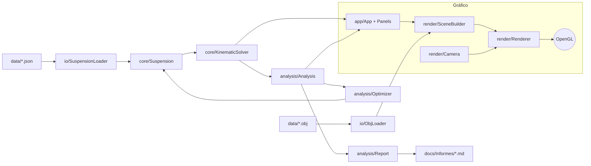

# Arquitectura

## Regla principal
**El cálculo no sabe nada de OpenGL.** Todo lo de `core/`, `analysis/` e `io/` forma la librería `suspcore`, que se puede usar desde la ventana, desde un test o desde un programa de consola. La parte gráfica (`render/`, `app/`) solo *lee* resultados y los dibuja.

Esto te permite depurar la física con el test (`test_kinematics`) sin abrir ninguna ventana.

## Carpetas

| Carpeta | Qué hay | Depende de OpenGL |
|---|---|---|
| `src/core/` | Datos de la suspensión (`Suspension.h`) y solver cinemático | No |
| `src/analysis/` | Parámetros, barridos, informe, optimizador | No |
| `src/io/` | Lectura/escritura JSON, lector OBJ | No |
| `src/render/` | Shader, cámara, renderer de primitivas, construcción de la escena | Sí |
| `src/app/` | Ventana, bucle principal, paneles de ImGui | Sí |
| `tests/` | Test de consola del núcleo | No |
| `third_party/glad/` | Cargador de OpenGL ya generado | — |
| `data/` | Modelos de ejemplo | — |
| `docs/` | Esta bóveda | — |
| `output/` | CSV generados (se crea solo) | — |

## Archivos clave

| Archivo | Para qué lo tocarás |
|---|---|
| `core/Suspension.h` | Añadir un punto duro o un parámetro de entrada nuevo |
| `core/KinematicSolver.cpp` | Cambiar cómo se mueve la suspensión |
| `analysis/Analysis.cpp` | Añadir un parámetro de salida nuevo (añádelo también a `Metrics`) |
| `analysis/Report.cpp` | Cambiar el formato del informe |
| `analysis/Optimizer.cpp` | Añadir objetivos o cambiar de algoritmo |
| `render/SceneBuilder.cpp` | Dibujar algo nuevo → [[Cómo dibujar algo nuevo]] |
| `app/Panels.cpp` | Botones, sliders, tablas → [[Dear ImGui en 5 minutos]] |

## Flujo de un cambio típico: "quiero ver el ángulo X"
1. Añadir `double x = 0;` a `Metrics` en `analysis/Analysis.h`.
2. Calcularlo en `computeGeometry()` (`analysis/Analysis.cpp`).
3. Mostrarlo: una línea `row("X", m.x, "deg");` en `panelResults()`.
4. Añadirlo al informe y al CSV (`analysis/Report.cpp`).
5. Comprobarlo en el test.

## Unidades
Todo en **mm, grados (en la salida) y radianes (dentro de los cálculos)**. Sistema de ejes en [[Sistema de coordenadas]].
